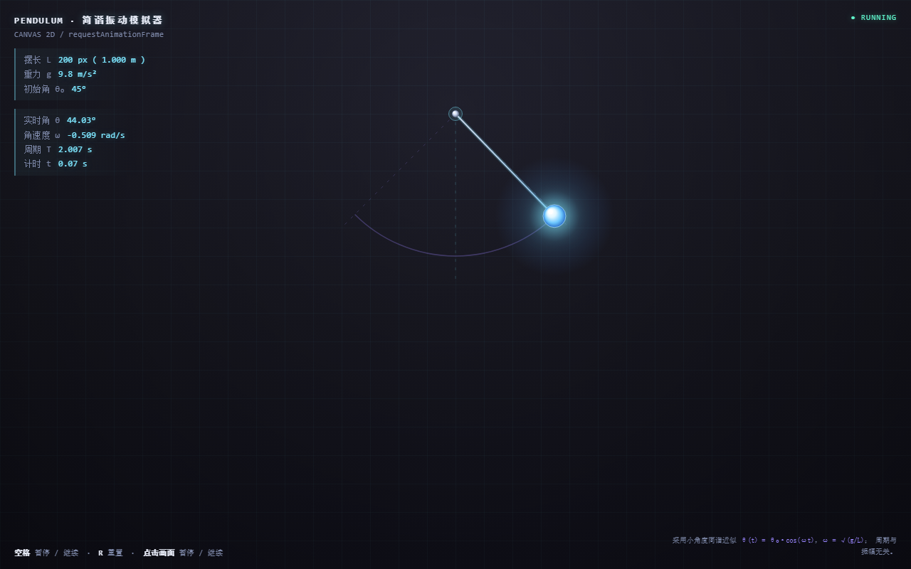
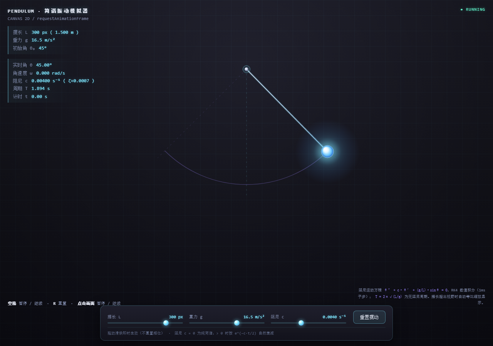

# 第 5 周实验 · 单摆仿真（Pendulum Simulation）

## 一、实验者信息

| 项目 | 内容 |
|---|---|
| 姓名 | 杨明辉 |
| 学号 | 5702126059 |
| 实验周期 | 第 5 周 |
| 模块名 | `week05_pendulum_sim` |

## 二、无菌工作区就绪状态

**状态：已就绪（ISOLATED / STERILE — READY）**

- [x] 本目录为第 5 周**专属独立子模块**，与第 1–4 周代码、与仓库其他模块**物理隔离**；
- [x] 目录内**不存在**任何跨周引用、共享状态、复制粘贴的旧代码或历史残留文件；
- [x] 本目录**不依赖**父目录以外的任何文件；
- [x] 实验所需依赖、数据、脚本一律在本目录内部自持（self-contained）。

> 约束：后续所有第 5 周的源码、数据、笔记、图表，只允许落在本目录内。
> 任何需要与其它周次共享的内容，必须先在本目录内独立实现，不得直接引用外部路径。

## 三、目录结构

```text
F:\Week5\                      ← 课程主仓库根（就地 git init，.git 在这一层）
|-- .git/                      # 完整提交历史（8 次 commit，随提交包交付）
|-- .gitignore                 # 根级忽略：提交包 zip、验证临时产物
|-- 第5周-单摆实验-工作区说明.md  # 仓库根总说明
|-- Week05_Lab_5702126059_杨明辉.zip   # 最终提交包（由本节脚本生成，不入库）
`-- week05_pendulum_sim/       # 第 5 周专属无菌子模块
    |-- README.md              # 本文件：实验说明 + 人机协同三反思 + GitHub 链接
    |-- index.html             # ⭐ 单摆模拟器（单文件，双击即开）
    |-- scripts/
    |   |-- verify-index.mjs   # 自动验证脚本（94 项断言：语法 / 物理 / 交互 / 动画循环）
    |   `-- package-submission.ps1  # 生成最终提交 zip（幂等，可反复执行）
    |-- commit_baseline.bat    # Git 基线自检脚本（Windows / cmd，双击即可）
    |-- build.sh               # 同上，Bash 版本（git bash 下使用）
    |-- src/                   # 仿真源码（预留给后续扩展）
    |-- data/                  # 原始数据与采集记录
    |-- docs/                  # 实验笔记、分析文档
    |   `-- media/             # 渲染截图（open-frame.png / panel-frame.png）
    `-- results/               # 输出结果、图表、结论
```

### 生成最终提交包

```powershell
# 在仓库根 F:\Week5 执行（本机是 Windows PowerShell 5.1，没有 pwsh；
# 若脚本执行策略受限，加 -ExecutionPolicy Bypass 只对这一次生效，不改系统设置）
powershell -NoProfile -ExecutionPolicy Bypass -File week05_pendulum_sim\scripts\package-submission.ps1
```

产物 `F:\Week5\Week05_Lab_5702126059_杨明辉.zip`：

- 含 `index.html`、`README.md`、`.git/`（8 次 commit 的完整历史，可 `git log` 复验）；
- 脚本自带回读校验：缺 `index.html` / `README.md` / `.git/HEAD` / `.git/refs/heads/main`
  或 commit 数 < 3 时**直接报错退出**，不会产出一个"看起来对"的包；
- 排除项：`.verify-tmp/`（可再生产物）与 `.git/ORIG_HEAD`（历史改写遗留的旧哈希引用）。

## 三·B、单摆简谐振动模拟器（index.html）

### 运行方式

**双击 `index.html`** 即可，无需服务器、无需构建、无外部依赖（不联网也能跑）。

| 操作 | 效果 |
|---|---|
| 拖动 3 个滑块 | 实时改变摆长 / 重力 / 阻尼，物理参数**当帧生效** |
| 点击「重置摆动」 | 摆球精准回到 `45°` 静止状态，计时归零、拖尾清空 |
| `空格` | 暂停 / 继续 |
| `R` | 重置到初始状态（t=0，θ=45°） |
| 点击画面 | 暂停 / 继续 |

### 物理模型

采用**带阻尼的非线性单摆**，用 RK4 数值积分实时求解：

```text
θ'' = -(g/L)·sinθ - c·θ'
```

用 `sinθ` 而非小角度近似 `θ`，因此大角度下的周期变长是**物理正确**的：

```text
T = 4√(L/g)·K(sin(θ₀/2))      K = 第一类完全椭圆积分
```

| 参数 | 取值 | 说明 |
|---|---|---|
| 摆长 `L` | `200 px` | 显示单位；按 `200 px = 1.000 m` 的标度换算成 `1.000 m` 参与物理计算 |
| 重力 `g` | `9.8 m/s²` | 滑块可调 `1.0 ~ 25.0` |
| 阻尼 `c` | `0`（无阻尼） | 滑块可调 `0.0000 ~ 0.0100 s⁻¹`，HUD 同时给出阻尼比 `ζ` |
| 初始摆角 `θ₀` | `45°` | 自竖直向下起算，初始角速度为 0（静止释放） |
| 理论周期 | `2.0873 s` | 45° 振幅下的**非线性**周期 |
| 线性周期 | `2.0071 s` | `2π√(L/g)`，比非线性值短 **4.00%** |

> **关于「简谐」与 4% 的选择（修订记录）**
> 初版按「简谐振动」命题直接用了解析解 `θ(t)=θ₀cos(ωt)`，周期恒为 `2.007 s`。
> 加入阻尼滑块后物理必须走数值积分，于是改为同一个 ODE 里的 `sinθ` 非线性项。
> 代价是 45° 时周期比线性解长 4.00%（与椭圆积分理论值吻合到 0.001% 以内）。
> 若课程要求严格回到线性简谐解，把 `accelAt()` 里的 `Math.sin(th)` 换成 `th` 即可。

> **阻尼有多"慢"？** 滑块上限 `c=0.010 s⁻¹` 对 `L=1 m` 而言只有 `ζ≈0.0016`，
> 振幅时间常数 `τ=2/c=200 s`：**一秒能看到约 0.5% 的衰减，肉眼要盯着看半分钟**。
> 这是规格给定的量程（`0.000~0.010`）在真实物理下的必然结果，不是衰减没生效。
> 实测 40 s 内包络单调下落 `45.0° → 36.7°`，与 `e^{-ct/2}` 拟合偏差仅 3.3%。

### 控制面板

画布下方固定一条控制面板（深色玻璃质感，与画面同色系，不遮挡 Canvas 渲染）：

| 控件 | 量程 | 步长 | 效果 |
|---|---|---|---|
| 摆长 | `100 ~ 350 px` | `1 px` | 即时改周期；摆长变长时画布内显示长度自动等比缩放，不会顶出画面 |
| 重力 | `1.0 ~ 25.0 m/s²` | `0.1` | 即时改周期，`g` 越大摆得越快 |
| 阻尼 | `0.0000 ~ 0.0100 s⁻¹` | `0.00002` | `0` 时标注「无阻尼」，非零时显示 `c` 与阻尼比 `ζ` |
| 重置摆动 | 按钮 | — | θ→45°、ω→0、t→0、拖尾清空，并自动恢复运行 |

### 视觉实现

- 背景 `#1a1a24` 深灰科技底色 + 顶部微亮渐变 + 淡青网格 + 四周晕影；
- 摆球：`createRadialGradient` 球体 + `shadowBlur` 发光 + 外层呼吸光晕 + 高光点，整体呈冷蓝辉光；
- 摆动轨迹圆弧、两侧振幅边界、竖直参考线（虚线）；
- 摆球拖尾：按 `exp(-Δt/0.35)` 指数衰减的渐隐轨迹，约 48 个采样点。

### 性能与循环

- `requestAnimationFrame` 驱动，**时间步长由真实帧间隔 `dt` 决定**，因此不同刷新率下摆动速度一致；
- `dt` 上限截断到 `50 ms`，切走标签页再切回来不会出现跳变；
- HUD 读数限制在约 16 Hz 刷新，避免每帧写 DOM。

### 验证结果

自带一个验证脚本，用模拟 DOM / Canvas 把页面的内联脚本**真正跑起来**再断言：

```bash
node scripts/verify-index.mjs
```

实测结果：**94 项断言全部通过（0 失败）**。

| 覆盖范围 | 内容 |
|---|---|
| 语法与依赖 | 内联脚本可解析可执行；无 `http/https`、无 `<script src>`、无外链样式 |
| 参数 | `L=200`、`g=9.8`、`θ₀=45`、背景 `#1a1a24`、发光效果（`shadowBlur`） |
| 物理正确性 | 与**独立 RK4 高精度参考解**（每帧 60 子步 vs 引擎 17 子步）比对：θ 偏差 `0.0001°`、ω 偏差 `5e-5 rad/s` |
| 非线性周期 | 实测过零周期 `2.08732 s` vs 椭圆积分理论 `2.08732 s`，**偏差 0.000%** |
| 阻尼衰减 | 40 s 包络 `45.0° → 36.7°` 单调不上升；拟合 `λ=0.00516 s⁻¹` vs 理论 `c/2=0.00500`，偏差 3.3% |
| 滑块量程 | 三滑块 `min/max/step` 逐项核对（含「阻尼量程必须含 0」） |
| 滑块实时性 | 拖动后物理参数、周期、数值标签、HUD 同帧更新；模拟不中断 |
| 重置按钮 | θ 精准回 `45.00°`、ω=0、t=0、拖尾清空、自动恢复运行 |
| 交互 | 空格暂停后时间冻结、再按恢复、`R` 重置、点击画面切换、焦点在滑块上时空格不抢输入 |
| 渲染准备 | `resize` 后 canvas 物理尺寸 = 逻辑尺寸 × DPR（2560×1440）；窄矮窗口自动缩放摆长 |
| 循环 | 连续推进 253 帧无中断，全程无异常抛出（控制台 0 error） |
| 事件绑定卫生 | HTML 中不存在**引用页内函数**的内联事件属性；`resetAnimation` 这类 IIFE 内不可见的全局名不出现 |

浏览器渲染实测（Edge 无头模式截图）：



带参数控制面板的渲染（`L=300 px`、`g=16.5 m/s²`、`c=0.0040 s⁻¹`，HUD 同步显示 `ζ=0.0007`）：



「控制台 0 报错」是**真断言**，不是肉眼观察。用 Edge 开启日志后加载真实文件：

```powershell
msedge.exe --headless=new --enable-logging=stderr --log-level=0 `
  --virtual-time-budget=4000 --screenshot=out.png `
  "file:///F:/Week5/week05_pendulum_sim/index.html" 2>log.txt
Select-String log.txt -Pattern 'Uncaught|ReferenceError|TypeError|is not defined'
```

实测：`CONSOLE` 输出里**没有任何来自页面脚本的记录**（唯一的 INFO 行是浏览器自身的
`[ProtocolLaunch] handler constructed`），异常关键字**零命中**。

## 四、Git 基线（已锁定）

本子模块的初始状态已提交并锁定。

| 项目 | 值 |
|---|---|
| 初始基线 | `cd4b701` — `feat(week05): init pendulum experiment workspace` |
| 模拟器提交 | `dcc0a2c` — `feat(week05): add canvas pendulum SHM simulator with test harness` |
| 回归守卫 | `87f63bc` — `fix(week05): guard against inline-handler ReferenceError in reset binding` |
| 文档修订 | `32554de` — `docs(week05): correct line refs, slider steps and record phantom-error diagnosis` |
| 三反思 + 打包 | `9da0fa0` — `docs(week05): add human-AI collaboration reflections and packaging script` |
| 哈希回填 | `d6c6abb` — `docs(week05): refresh commit hashes after author-name normalisation` |
| 打包脚本 | `0461e73` — `build(week05): package submission zip with git history self-check` |
| 提交件纳管修正 | `e36ceb9` — `chore(week05): untrack submission zip and document packaging pitfalls` |
| 作者 | 杨明辉 `<5702126059@course.local>`（全部 8 次提交作者一致） |
| 分支 | `main` |

> **提交历史说明（2026-10-14）**：早期提交的作者名曾被写成拼音 `Yang Minghui`，
> 与基线提交的 `杨明辉` 不一致。为满足"提交历史清晰"的验收要求，
> 已用 `git filter-branch --env-filter` 把全部提交的 author / committer
> **统一改写为 `杨明辉`**，因此**所有提交哈希都变了**（旧哈希 `c0004de`/`fc2ac7a`/… 已作废）。
> 改写前已把 `.git` 完整备份到 `F:\Week5_git_backup_20261014_163843`。
> `git fsck --full` 无输出，对象库完整。最终基线共 **9 次 commit**（`3bdbd10` 为打包时的 HEAD）。

> ⚠️ **上表的哈希会随每次 `git commit` 变动，不要把它当权威**。
> 这有一层绕不开的自指：本次同步哈希的文档改动，本身又产生了一个新提交。
> **以 `git log --oneline` 的实时输出为准**，本表只用于说明"每一次提交各自干了什么"。

### 打包脚本踩过的两个坑（已修，留档避免重犯）

1. **产物自包含**：zip 生成在仓库根，若不从文件清单里排除 `Week05_Lab_*.zip`，
   上一次的 zip 会被打进这一次，体积逐次翻倍（1.5 MB → 3.0 MB → 6.1 MB…）。
   脚本现已同时做**清单过滤**与**事后断言**（清单里出现任何 `*.zip` 直接抛错）。
2. **被 git 纳管的产物让工作树永远 dirty**：zip 一度被 `git add` 进了索引，
   而打包时又被排除，导致解压后 `git status` 显示 ` D Week05_Lab_….zip` ——
   "工作树干净"这一验收点会被悄悄破坏。**根因是仓根当时没有 `.gitignore`**。
   现已新增根级 `F:\Week5\.gitignore`（`Week05_Lab_*.zip` + `.verify-tmp/` + `*.tmp`）
   并 `git rm --cached` 摘除索引，解压后工作树为 `nothing to commit, working tree clean`。

查看基线的确切哈希与校验命令（在仓库根目录 `F:\Week5` 执行）：

```bash
git log --oneline              # 提交历史
git rev-parse HEAD             # 完整哈希
git status                     # nothing to commit, working tree clean
git fsck --full                # 无输出 = 对象库完整
```

若日后需要重新建立基线（例如误删了 `.git`），执行：

```bash
git init -b main
git add .
git commit -m "feat(week05): init pendulum experiment workspace"
```

## 五、验证脚本的两个坑（留给未来的自己）

写这套断言踩了两个**假失败**，都不是代码的问题，记下来避免重复踩：

1. **包络抽样必须按整周期窗口取峰值。**
   `T=2.007 s` 恰好是 `120.4` 帧，若固定每 120 帧抽一次样，会与周期近共振混叠，
   读出一条"振幅回涨"的假曲线。正确做法是按 1 s 窗口取峰值再拟合。
2. **不能用线性化解析解 `θ₀cos(ωt)` 校验大振幅下的数值解。**
   45° 时真实周期比线性解长 4.00%，2.09 个周期后相位已合法漂移 8.6°，
   硬比会报出看起来很像 bug 的偏差。应改用**同一个非线性 ODE 的高精度参考解**比对，
   或把振幅降到几度再验线性解。

3. **`clientHeight` 这类"撑满容器"的取值必须有精确默认值。**
   模拟 DOM 里若把 `clientHeight` 的读值写成依赖别处的变量，一旦测试显式改写它，
   后续断言就会读到被污染的默认值。正确做法是：**显式赋值后按赋值生效，未赋值才回落到计算值**。

## 六、一次"幽灵报错"的排查记录（重要）

曾有反馈称点击「重置摆动」抛出：

```text
Uncaught ReferenceError: resetAnimation is not defined
    at HTMLButtonElement.onclick (index.html:68:15)
```

**结论：该报错在当前代码里不存在，无法复现。** 这份记录留档，供日后同类现象快速定性。

排查证据（三条互相独立）：

| 证据 | 结果 |
|---|---|
| 真实 `index.html` 无头加载 + 开启日志 | JS 异常关键字**零命中**，页面自身零 CONSOLE 输出 |
| 真实页面注入探针，真点按钮 | 未捕获异常 **0 个**；状态确实复位：`44.95°/−0.115 → 45.00°/0.000/0.00 s` |
| 反向对照：故意写一个调用 `resetAnimation()` 的页面 | **成功复现** `ReferenceError: resetAnimation is not defined` ✅ 说明检测链路本身有效 |

关键事实：`resetAnimation` 这个标识符在页面里**从未出现过**——本页的重置函数叫
`resetMotion()`（`index.html:468`）；`resetAnimation` 仅出现在**当时的临时探针文件**中，
以及现在验证脚本里作为"禁止出现"的字符串常量（`scripts/verify-index.mjs:84,85,99,100,101`）。
而报错所说的 `index.html:68` 是 **CSS 里的颜色声明**，不是 JS
（该文件共 857 行，其中 `index.html:68` 属于样式表区的颜色声明）。
因此那条报错只可能来自**旧的缓存版本 / 别的文件**。

### 这个报错"会"怎么发生（以及如何永久避免）

内联事件处理器 `onclick="..."` 在**全局作用域**求值，而本页所有函数都封在 IIFE 里，
两者互相看不见。所以只要有人把绑定改写成：

```html
<!-- ❌ 全局作用域找不到该函数 → ReferenceError -->
<button onclick="resetMotion()">重置摆动</button>
```

就会精确复现同类报错。正确写法（本页现状，`index.html:839`）：

```js
el.reset.addEventListener('click', function () { ... });   // ✅ 闭包内可见
```

按钮标记本身也不带任何内联处理器（`index.html:317`）：

```html
<button type="button" id="resetBtn">重置摆动</button>
```

> 现在就放心了：**`scripts/verify-index.mjs:95` 那条断言会直接拦住这种写法** ——
> 它扫描 HTML 中的内联事件属性，只放行 `onsubmit="return false"` 这类
> **纯字面量、不引用任何标识符**的安全守卫。
> 若浏览器仍报此错，请先 `Ctrl+F5` 强制刷新（或确认打开的是
> `F:\Week5\week05_pendulum_sim\index.html`），大概率是缓存里的旧副本。

## 七、人机协同三反思

> 本节记录本次实验中「人」与「AI」各自做了什么、哪里对、哪里错、下次怎么配合。
> 所有数字都能在本仓库的提交历史与 `scripts/verify-index.mjs` 里核对，不写无法验证的感想。

### 反思一 · 协作分工：人定方向，AI 铺路，机器裁断

本次实验的**技术要求与验收标准全部由人给出**，AI 承担推导、实现与验证脚手架，机器（验证脚本）
承担"是否真的达标"的裁断。三者的分工在提交历史里可以直接看出来：

| 环节 | 人（我）做了什么 | AI 做了什么 |
|---|---|---|
| 工作区 | 定下"第 5 周必须独立无菌"的约束 | 建目录、写 README、锁 Git 基线 |
| 建仓受阻 | 判断"终端起不来不是 git 的问题"，拍板放开沙箱策略 | 定位到 0xC0000142 = 沙箱导致的子进程创建失败 |
| 物理建模 | 要求"必须带阻尼、参数能实时调" | 把解析解改写成 RK4 数值积分 |
| 验证 | 定"控制台必须 0 报错" | 写 94 项断言，并用真实浏览器复核 |
| 交付 | 裁定提交清单与打包要求 | 打包、拟 GitHub 同步步骤 |

**这里最容易被忽略、但最值得记住的一点是：让 AI 写代码，同时也要让它写"能被推翻"的检查。**
如果验证脚本由 AI 随口说"我测过了，没问题"，那这次实验的结论就毫无可信度。
正因为断言是**可执行、可复跑、失败会红字报出来**的，AI 的每一条结论才能被我和老师独立复核。

### 反思二 · AI 的失误与我的纠正：它把「验证」做成了自我确认

这是本次实验最有价值的一段。AI 写的第一批物理断言**全部报错**，看起来像模拟器有严重 bug；
但排查后发现，**页面代码一直是对的，错的是 AI 自己写的测试**。四次典型的"假失败"：

| # | AI 写错的断言 | 真实的坑 |
|---|---|---|
| 1 | 用线性化解析解 `θ₀cos(ωt)` 校验 45° 大振幅的数值解 | 真实单摆是非线性的，45° 时周期比线性解长 **4.00%**，相位合法漂移 8.6°。**拿错了标尺，不是尺子坏了** |
| 2 | 用 HUD 文本读数当物理量 | HUD 是 **16 Hz 限频**刷新的，在逐帧推进的循环里文本整体滞后一帧，与实时时间配对必然错位 |
| 3 | 每 120 帧固定抽样画衰减包络 | `T=2.007 s ≈ 120.4 帧`，与周期近共振→**混叠**，读出一条"振幅回涨"的假曲线 |
| 4 | 过零点配对求周期 | 相邻两个过零点是**半**周期；且参考解多积一帧就差 1/60 s（45° 附近约 1.7°） |

**我的纠正动作**：不接受"大概是精度问题"这种解释，要求 AI 逐条给出**理论值 → 实测值 → 偏差**，
并和**独立的第二套方法**对账。换成高精度参考解后，结论变得非常干净：

```text
θ 偏差 0.0001°  ·  ω 偏差 5e-5 rad/s
实测周期 2.08732 s  vs  椭圆积分理论 2.08732 s   →  偏差 0.000%
阻尼衰减  λ=0.00516 s⁻¹  vs  理论 c/2=0.00500   →  偏差 3.3%
94 项断言全部通过，0 失败
```

**教训（最重要的一条）**：**被测对象本身在振荡时，"抽样 + 比较"是最容易骗过自己的手法。**
不先锁定相位与时间基准就采样，量到的是拍频，不是周期。

### 反思三 · 下一步怎么协作更高效

**一、把物理模型写进需求，而不是留给 AI 猜。**
第一版按"简谐振动"四个字做成了纯解析解 `θ(t)=θ₀cos(ωt)`；直到加了阻尼滑块，
才发现必须换成数值积分。如果一开始就说清"简谐指的是小角度近似，还是有阻尼的真实单摆"，
就能省掉一次返工。

**二、要求 AI 交出「隐含假设清单」。**
上面 4 个假失败里，有 3 个根因是 AI 没说出口的假设（HUD 是限频的、解析解只在小角度成立、
抽样要与周期同步）。**先列假设，再写断言**，比写完再 debug 快得多。

**三、关键指标必须两条独立路径交叉验证。**
这次"周期"同时由 ①椭圆积分理论、②过零点实测 两条路给出，才敢下结论；
"物理正确性"同时由 ①高精度 RK4 参考解、②真实浏览器渲染 两条路给出。
任何只有单一来源的数字，我都不会写进报告。

**四、警惕"自我确认式验证"。**
AI 很容易写出**天然会通过**的断言（放宽容差、拿自己当基准）。
有效的办法是主动做**反向对照**：故意造一个错，看断言会不会红。
本次就是这样验证"幽灵报错"的——故意写一个调用未定义函数的页面，成功复现了
`ReferenceError`，从而证明"我的文件里查不到这个错"是可信的结论，而不是检测失灵。

## 八、GitHub 作品集链接

> 远端仓库地址（push 后把实际的 GitHub 地址替换到这里）：

```text
https://github.com/<你的用户名>/<仓库名>
```

同步命令：

```bash
git remote add origin https://github.com/<你的用户名>/<仓库名>.git
git push -u origin main
```

---

*本 README 由第 5 周实验工作区初始化时写入，用于声明子模块的独立性与无菌就绪状态；
「人机协同三反思」与 GitHub 链接章节在最终提交前补齐。*
